<div align="center">

**[🇹🇷 Türkçe](README.md) · 🇬🇧 English**

# ✏️ Doodle Portfolio Template

**A sketchbook-themed personal website template that draws itself as you scroll.**
White notebook / black notebook · Turkish / English · 6 pages + blog + admin panel · no build step, just double-click.

[](https://nazifw.github.io/doodle-portfolio-template/)
[](https://github.com/nazifw/doodle-portfolio-template/generate)


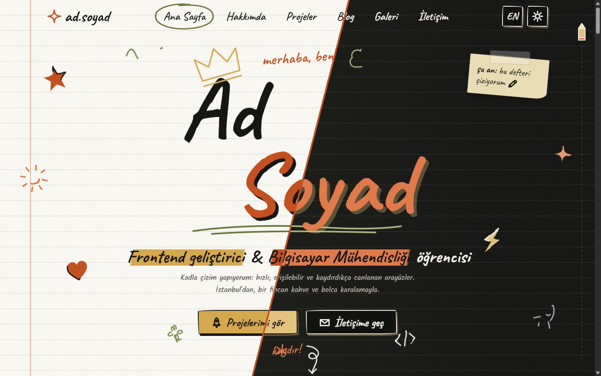

</div>

---

## 🎬 What happens when you scroll?

<div align="center">
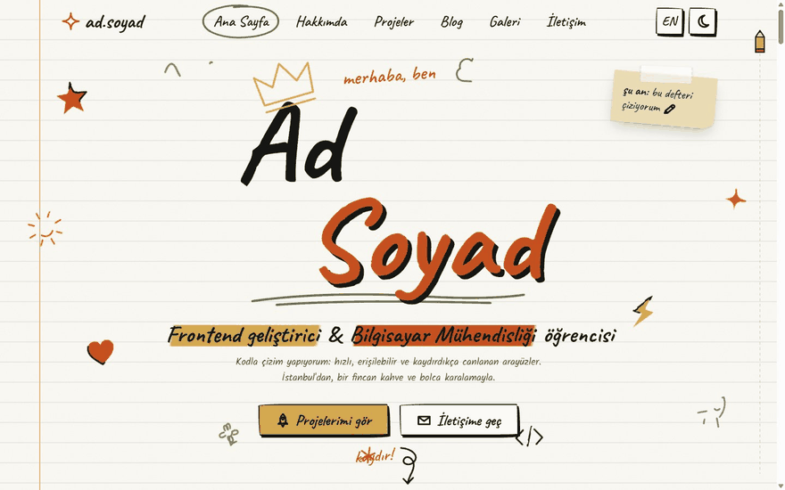
</div>

- **Headings that bounce in letter by letter**, arrows and scribbles that draw themselves, highlighter marks that paint as you scroll
- **Pinned sections**: a manifesto that inks word by word, a sketchbook strip that slides sideways, a project deck that fans out
- **Juice**: buttons squash and stretch when pressed, clicks burst into ink particles, hover makes them wiggle
- **Pencil cursor**: leaves an ink trail and wraps buttons in a hand-drawn frame
- **Page transitions**: a yellow notebook-page curtain, with a "hello!" on the first visit

## 📄 Pages

| | |
|---|---|
| 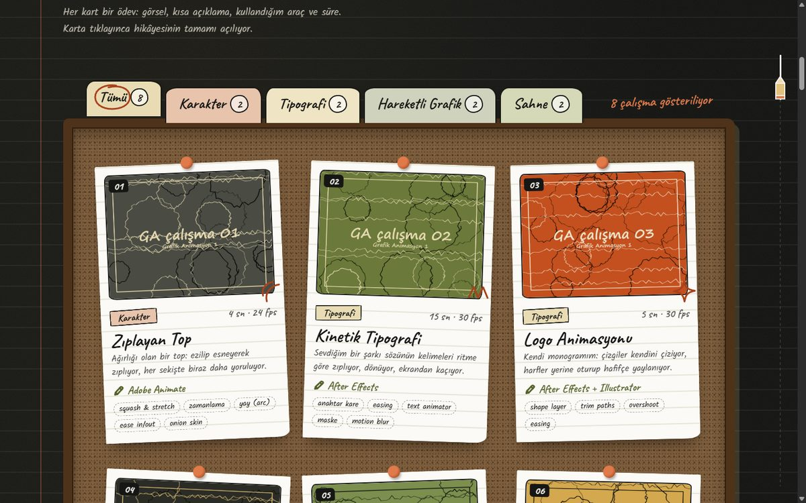 | 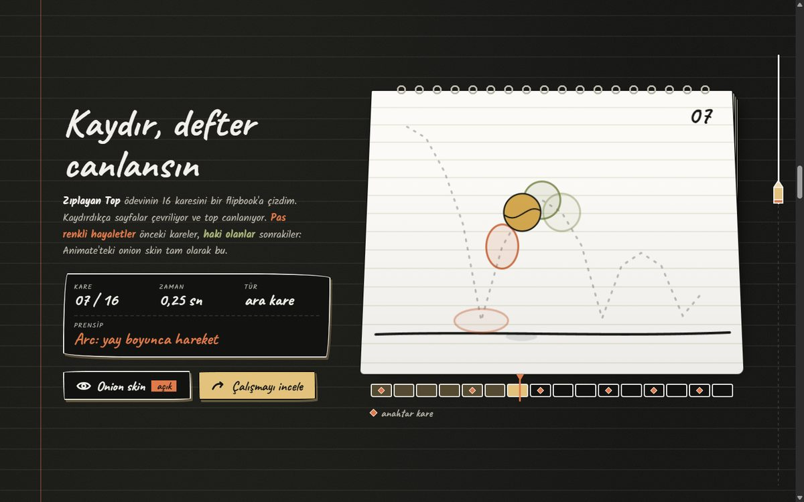 |
| **Projects** — a corkboard, a FLIP-animated filter, a detail panel that grows out of the card | **Flipbook** — a bouncing ball whose frames flip as you scroll, onion skin, a timeline |
| 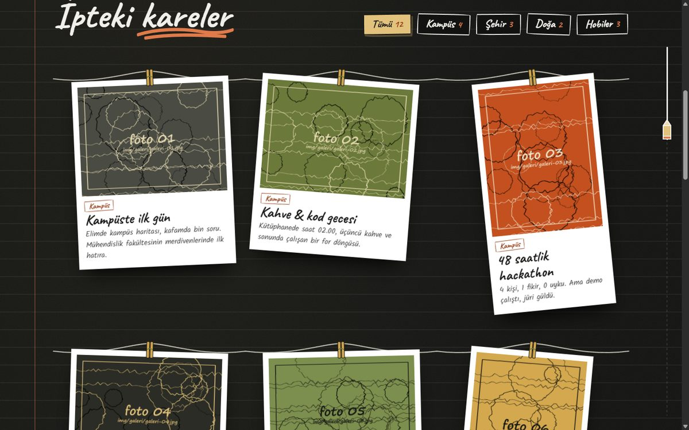 | 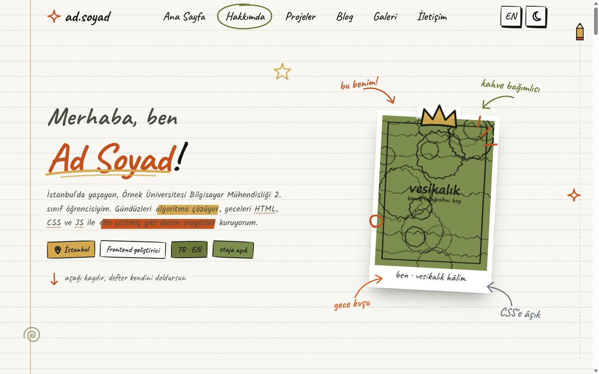 |
| **Gallery** — a "darkroom": photos on a line that sway with the cursor, plus a lightbox | **About** — an ID-photo polaroid, a résumé path, skill percentages |
| 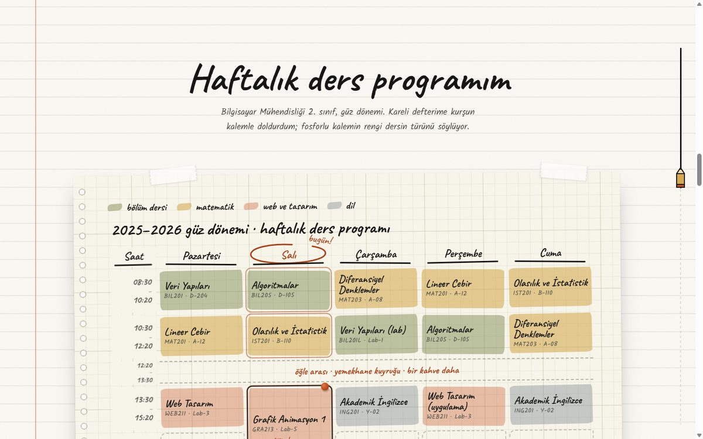 | 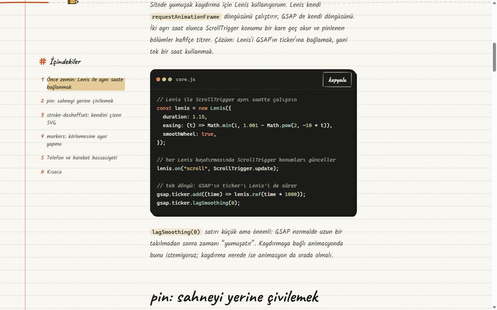 |
| **Class schedule** — a real `<table>`; cells fill in with highlighter, "today" is circled | **Blog** — 3 sample posts, table of contents, reading progress, code blocks, screenshots |
| 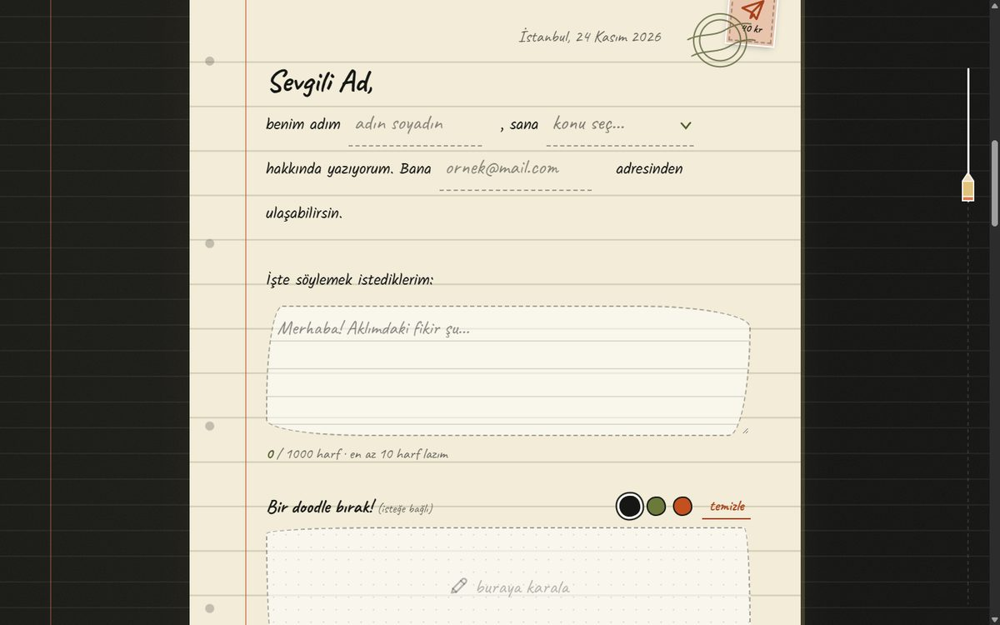 | 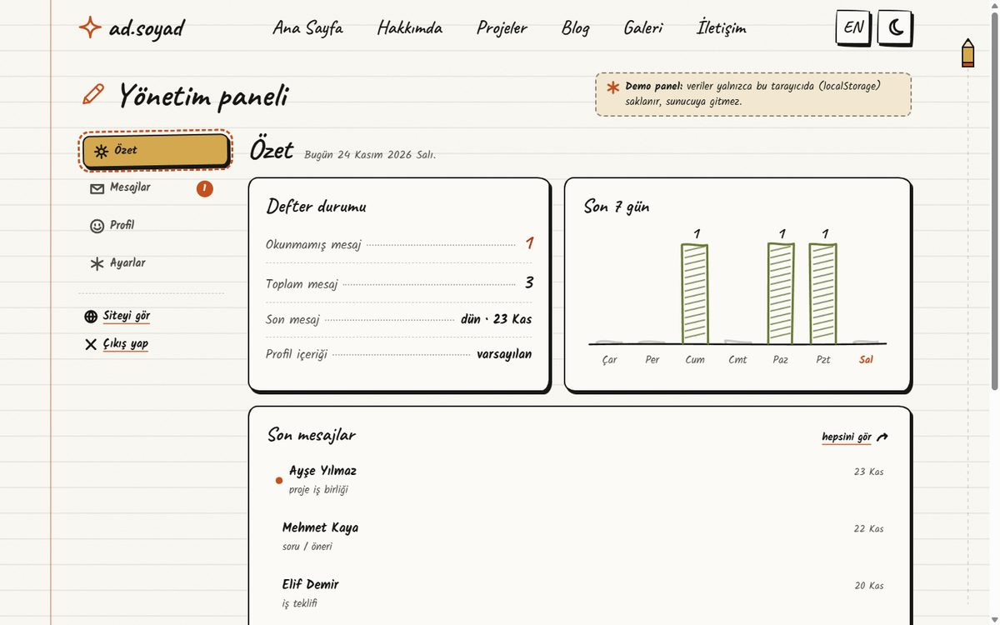 |
| **Contact** — a fill-in-the-blanks letter form that folds into a paper plane and flies off when sent | **Admin panel** — incoming messages, profile editing, backups (runs in the browser) |

## 📱 On a phone

<div align="center">
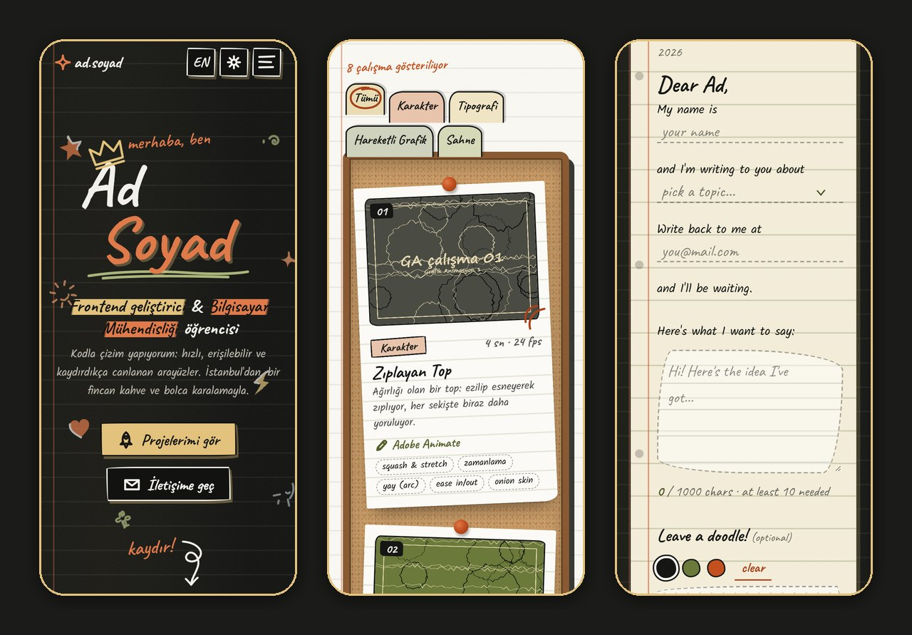
</div>

Mobile first: no horizontal overflow from 360 px up to wide screens, and every touch target is at least 44 px.

## ✨ Features

- **6 pages + blog**: Home, About, Projects, Blog (+3 posts), Gallery, Contact
- **Two languages**: an in-page TR/EN toggle — text, titles, meta descriptions and alt text switch instantly
- **Two themes**: white notebook with black ink / black notebook with white ink; accents in khaki · sand · rust
- **Accessible**: a single `h1`, a sensible heading order, full keyboard support, focus-trapped dialogs, `prefers-reduced-motion` support
- **SEO + GEO**: a separate title/description on every page, JSON-LD (Person, Blog, ImageGallery, ContactPage…), `sitemap.xml`, `robots.txt`, `llms.txt`
- **Fast**: critical font preloading, animations that are set up only when they enter the screen, lazy images, a photo optimisation script
- **Works offline**: GSAP, Lenis and the fonts are bundled; no internet needed
- **Admin panel** (`admin.html`): messages from the contact form, profile details, backup and restore

## 🚀 Quick start

```bash
# 1) Create your own repo from the template ("Use this template") or clone it
git clone https://github.com/nazifw/doodle-portfolio-template.git
cd doodle-portfolio-template

# 2) Open it — no build step
start index.html        # Windows   (macOS: open index.html)
```

To try it with a local server: `python -m http.server` → <http://localhost:8000>

## 🛠️ Make it yours

1. **Your details**: replace "Ad Soyad" (Name Surname), `ornek@mail.com`, the phone number and the address in the HTML. (Or use `admin.html` → Profile; that only shows up in that browser.)
2. **Your photos**: replace them using the same file names, then shrink them:
   ```
   img/profil/vesikalik.jpg      img/galeri/galeri-01..12.jpg      img/projeler/ga-01..08.jpg
   ```
   ```bash
   python tools/optimize_images.py   # size + aspect ratio + EXIF cleanup (requires Pillow)
   ```
3. **Your domain**: replace `ornek-alanadi.com` in `sitemap.xml` and `robots.txt`.
4. **Shared menu/footer**: `python tools/shell.py *.html` (don't edit the nav by hand).
5. **Submission package** (for coursework): `python tools/teslim.py STUDENT_NO` → `STUDENT_NO-WEB.PDF`

The admin panel's default password is **`vize2026`** — change it under Settings. The panel is for demo purposes: data lives in the browser (localStorage) and it provides no real security.

> The site's own text is in Turkish by default (page and file names too: *hakkimda* = about, *projeler* = projects, *galeri* = gallery, *iletisim* = contact). The English version of every string lives in the dictionaries in `js/pages/*.js`.

## 📁 Structure

```
├── index.html, hakkimda.html, projeler.html, galeri.html, iletisim.html, admin.html
├── blog.html, blog-*.html          # blog + 3 posts
├── css/
│   ├── core.css                    # design system (tokens, components, themes)
│   └── pages/*.css                 # page-specific styles
├── js/
│   ├── core.js                     # engine: cursor, juice, i18n, scroll animations, transitions
│   ├── pages/*.js                  # page-specific effects + English dictionaries
│   └── vendor/                     # GSAP, ScrollTrigger, Lenis (bundled)
├── fonts/                          # Caveat + Kalam (woff2, with Turkish characters)
├── img/                            # placeholder images
├── tools/                          # shell.py, optimize_images.py, placeholders.py, teslim.py
├── DESIGN.md                       # design system and rules (in Turkish)
└── kaynak.txt                      # credits and sources
```

The design system, declarative animation attributes such as `data-reveal` / `data-split` / `data-draw`, and the `window.Doodle` API are documented in **[DESIGN.md](DESIGN.md)** (Turkish).

## 📜 License and credits

The template's code is licensed under **MIT** — see [LICENSE](LICENSE).
Bundled third-party components keep their own licenses:
[GSAP](https://gsap.com/standard-license) (GreenSock Standard License) ·
[Lenis](https://github.com/darkroomengineering/lenis) (MIT) ·
[Caveat](https://fonts.google.com/specimen/Caveat) and [Kalam](https://fonts.google.com/specimen/Kalam) (SIL Open Font License).
Details: [kaynak.txt](kaynak.txt).

<div align="center"><sub>Drawn with a pencil, coffee and a little JavaScript. ✏️</sub></div>
