<div align="center">

**🇹🇷 Türkçe · [🇬🇧 English](README.en.md)**

# ✏️ Doodle Portföy Şablonu

**Kaydırdıkça kendini çizen, eskiz defteri temalı kişisel web sitesi şablonu.**
Beyaz defter / siyah defter · Türkçe / English · 6 sayfa + blog + admin paneli · build yok, çift tıkla çalışır.

[](https://nazifw.github.io/doodle-portfolio-template/)
[](https://github.com/nazifw/doodle-portfolio-template/generate)


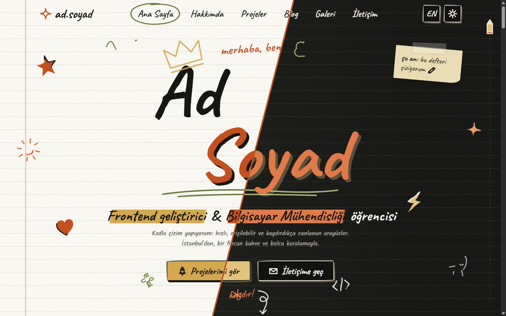

</div>

---

## 🎬 Kaydırınca ne oluyor?

<div align="center">
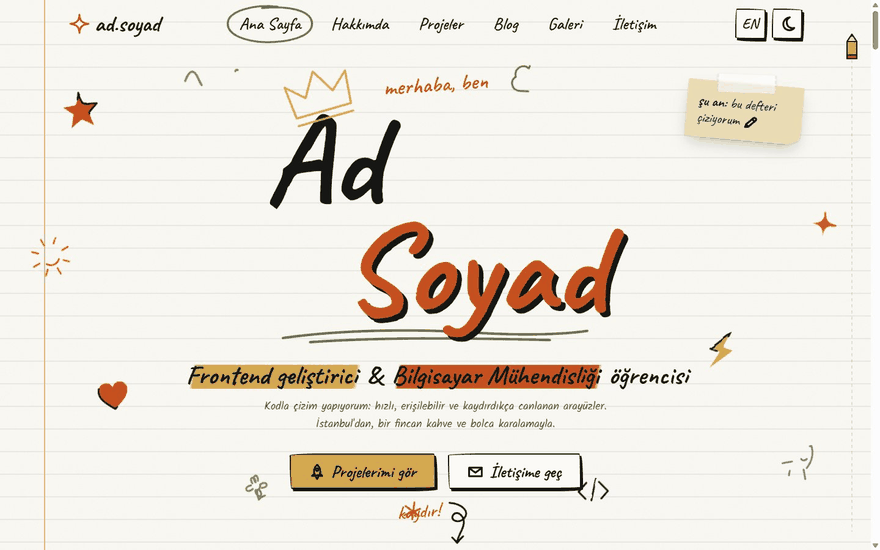
</div>

- **Harf harf zıplayan başlıklar**, kendini çizen oklar ve karalamalar, kaydırdıkça boyanan fosforlu kalem vurguları
- **Sabitlenen bölümler**: kelime kelime mürekkeplenen manifesto, yatay akan eskiz defteri, yelpaze gibi açılan proje destesi
- **Juice**: butonlar basınca ezilip yaylanır, tıklamada mürekkep parçacıkları saçılır, hover'da kıpırdar
- **Kalem imleç**: ardında mürekkep izi bırakır, butonlara gelince onları elle çizilmiş bir çerçeveyle sarar
- **Sayfa geçişleri**: sarı defter yaprağı perdesi, ilk girişte "merhaba!"

## 📄 Sayfalar

| | |
|---|---|
| 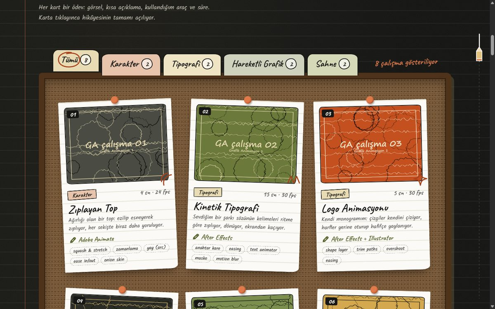 | 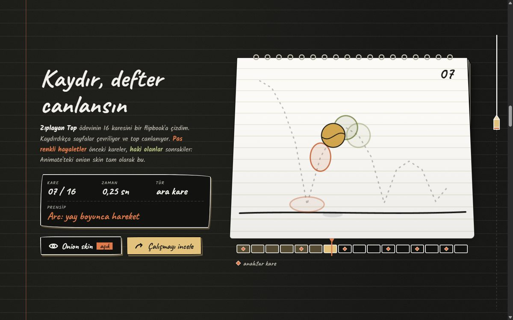 |
| **Projeler** — mantar pano, FLIP animasyonlu filtre, karttan genişleyen detay penceresi | **Flipbook** — kaydırdıkça kareleri çevrilen zıplayan top, onion skin, zaman çizelgesi |
| 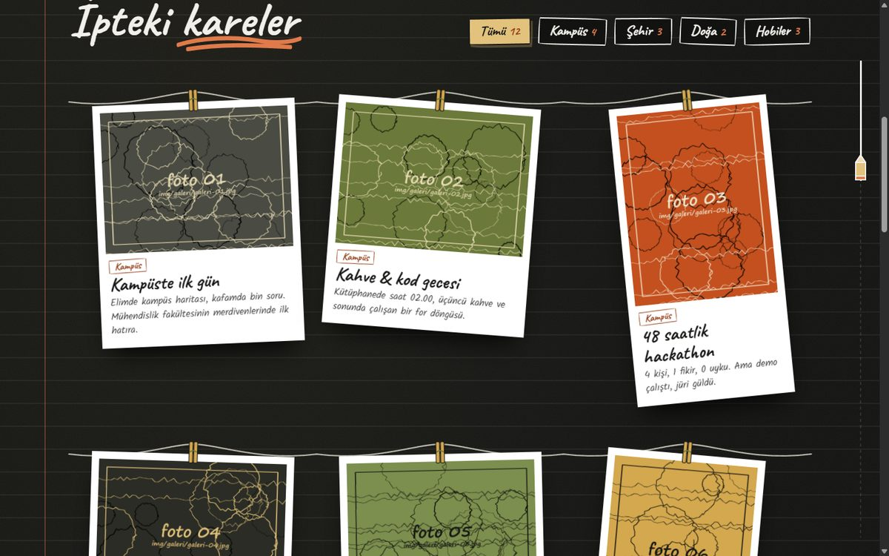 | 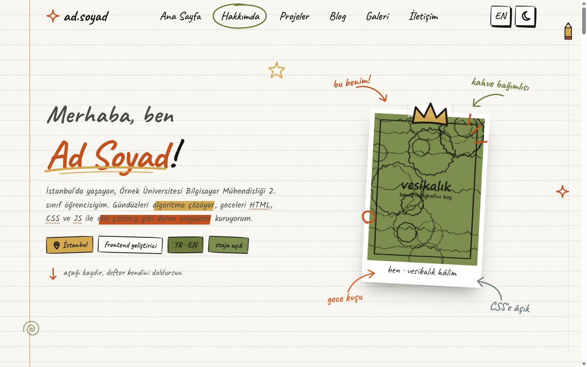 |
| **Galeri** — "karanlık oda": ipe asılı, imleçle sallanan fotoğraflar + lightbox | **Hakkımda** — vesikalık polaroid, özgeçmiş yolu, yetenek yüzdeleri |
| 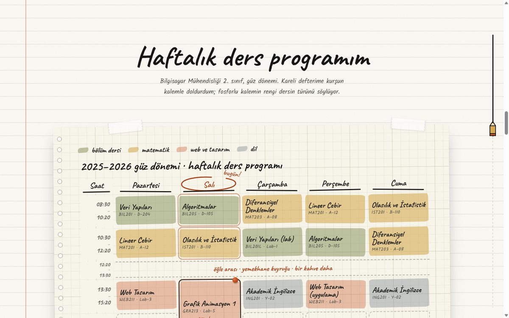 | 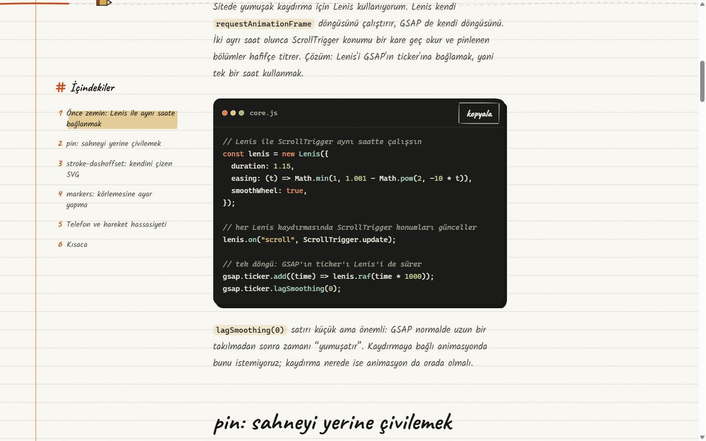 |
| **Ders programı** — gerçek `<table>`, hücreler fosforlu kalemle dolar, "bugün" işaretlenir | **Blog** — 3 örnek yazı, içindekiler, okuma ilerlemesi, kod blokları, ekran görüntüleri |
| 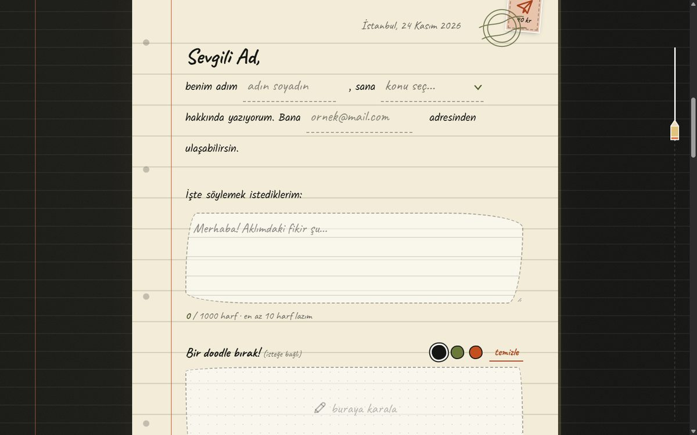 | 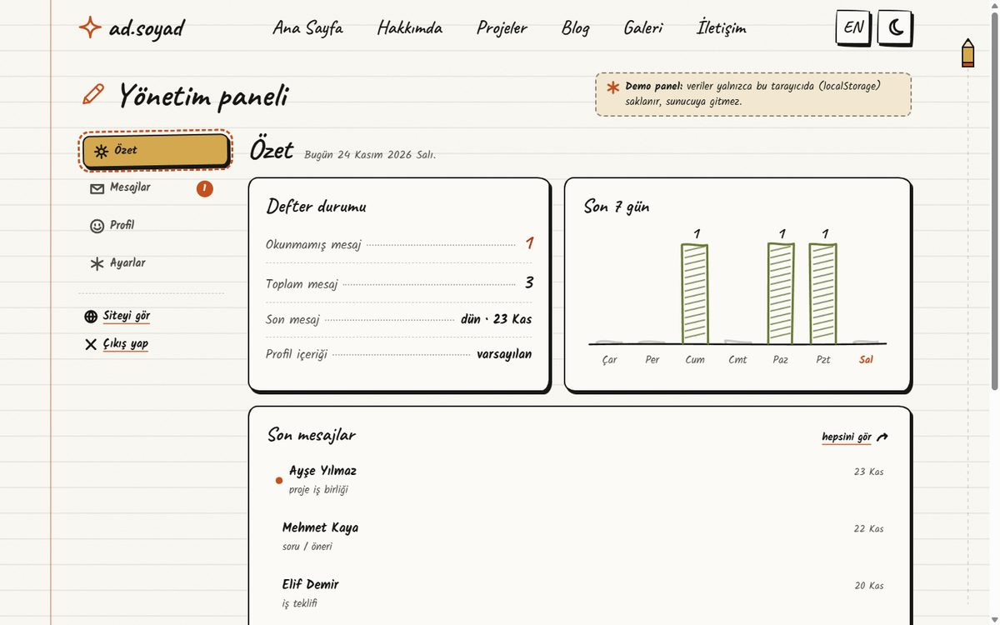 |
| **İletişim** — boşluk doldurmalı mektup formu; gönderince kağıt uçağa katlanıp uçar | **Admin paneli** — gelen mesajlar, profil düzenleme, yedekleme (tarayıcıda çalışır) |

## 📱 Telefonda

<div align="center">
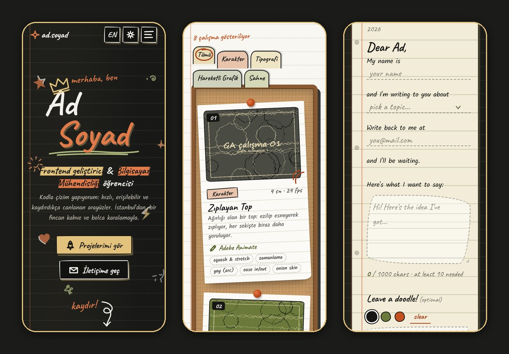
</div>

Mobile first; 360 px'ten geniş ekranlara kadar yatay taşma yok, dokunmatik hedefler en az 44 px.

## ✨ Özellikler

- **6 sayfa + blog**: Ana sayfa, Hakkımda, Projeler, Blog (+3 yazı), Galeri, İletişim
- **İki dil**: sayfa içi TR/EN düğmesi — metinler, başlıklar, meta açıklamaları, alt metinler anında değişir
- **İki tema**: beyaz defter + siyah mürekkep / siyah defter + beyaz mürekkep; vurgular haki · kum · pas
- **Erişilebilir**: tek `h1`, anlamlı başlık sırası, klavye ile tam kullanım, odak tuzaklı pencereler, `prefers-reduced-motion` desteği
- **SEO + GEO**: her sayfada ayrı title/description, JSON-LD (Person, Blog, ImageGallery, ContactPage…), `sitemap.xml`, `robots.txt`, `llms.txt`
- **Hızlı**: kritik font preload, ekrana girince kurulan animasyonlar, lazy görseller, fotoğraf optimizasyon aracı
- **Çevrimdışı çalışır**: GSAP, Lenis ve fontlar projenin içinde; internet gerekmez
- **Admin paneli** (`admin.html`): iletişim formundan gelen mesajlar, profil bilgileri, yedek al/yükle

## 🚀 Hızlı başlangıç

```bash
# 1) Şablondan kendi deponu oluştur ("Use this template") ya da klonla
git clone https://github.com/nazifw/doodle-portfolio-template.git
cd doodle-portfolio-template

# 2) Aç — build yok
start index.html        # Windows   (macOS: open index.html)
```

Yerel sunucuyla denemek istersen: `python -m http.server` → <http://localhost:8000>

## 🛠️ Kişiselleştirme

1. **Bilgilerin**: HTML'deki "Ad Soyad", `ornek@mail.com`, telefon ve adresi değiştir. (Ya da `admin.html` → Profil; bu yalnızca o tarayıcıda görünür.)
2. **Fotoğrafların**: aynı adlarla değiştir, sonra küçült:
   ```
   img/profil/vesikalik.jpg      img/galeri/galeri-01..12.jpg      img/projeler/ga-01..08.jpg
   ```
   ```bash
   python tools/optimize_images.py   # boyut + oran + EXIF temizliği (Pillow gerekir)
   ```
3. **Alan adın**: `sitemap.xml` ve `robots.txt` içindeki `ornek-alanadi.com`'u değiştir.
4. **Ortak menü/footer**: `python tools/shell.py *.html` (nav'ı elle düzenleme).
5. **Teslim paketi** (ödev için): `python tools/teslim.py OGRENCI_NO` → `OGRENCI_NO-WEB.PDF`

Admin paneli varsayılan şifresi: **`vize2026`** — Ayarlar'dan değiştir. Panel demo amaçlıdır; veriler tarayıcıda (localStorage) tutulur, gerçek güvenlik sağlamaz.

## 📁 Yapı

```
├── index.html, hakkimda.html, projeler.html, galeri.html, iletisim.html, admin.html
├── blog.html, blog-*.html          # blog + 3 yazı
├── css/
│   ├── core.css                    # tasarım sistemi (tokenlar, bileşenler, tema)
│   └── pages/*.css                 # sayfaya özel stiller
├── js/
│   ├── core.js                     # motor: imleç, juice, i18n, kaydırma animasyonları, geçişler
│   ├── pages/*.js                  # sayfaya özel efektler + İngilizce sözlükler
│   └── vendor/                     # GSAP, ScrollTrigger, Lenis (yerel)
├── fonts/                          # Caveat + Kalam (woff2, Türkçe karakterli)
├── img/                            # yer tutucu görseller
├── tools/                          # shell.py, optimize_images.py, placeholders.py, teslim.py
├── DESIGN.md                       # tasarım sistemi ve kurallar
└── kaynak.txt                      # kullanılan kaynaklar
```

Tasarım sistemi, `data-reveal` / `data-split` / `data-draw` gibi bildirimsel animasyon öznitelikleri ve `window.Doodle` API'si **[DESIGN.md](DESIGN.md)** içinde.

---

> 🇬🇧 **English version:** the full README is available in **[README.en.md](README.en.md)**.

## 📜 Lisans ve kaynaklar

Şablonun kodu **MIT** lisanslıdır — bkz. [LICENSE](LICENSE).
Dahil edilen üçüncü taraf kaynakların kendi lisansları geçerlidir:
[GSAP](https://gsap.com/standard-license) (GreenSock Standard License) ·
[Lenis](https://github.com/darkroomengineering/lenis) (MIT) ·
[Caveat](https://fonts.google.com/specimen/Caveat) ve [Kalam](https://fonts.google.com/specimen/Kalam) (SIL Open Font License).
Ayrıntılar: [kaynak.txt](kaynak.txt).

<div align="center"><sub>Kalemle, kahveyle ve biraz JavaScript'le çizildi. ✏️</sub></div>
